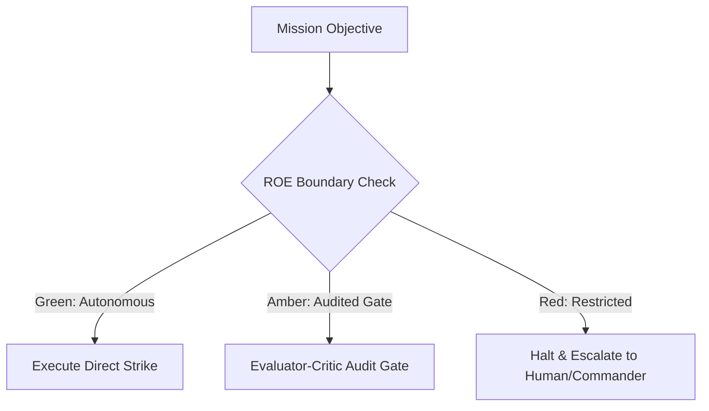
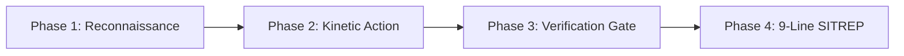

# Paramilitary Fleet Operations & Command Doctrine

This skill equips autonomous software engineering agents with military-grade operational discipline, structured chain of command, deterministic pre-flight inspections, resilient failover channels, and verifiable mission handoffs.

## 1. Core Operating Philosophy: Auftragstaktik (Mission Command)

Under Auftragstaktik, commanders communicate the **strategic intent** and operational boundaries rather than micromanaging every keystroke. Autonomous agents have full tactical autonomy within their sector to solve problems, adapt to unexpected obstacles, and complete the mission without pausing for permission on non-destructive tasks.

### Sovereign Mandates
- **Outcome over Ceremony**: Agents are judged strictly by operational outcomes, contract preservation, and binary **Proof of Life** verification.
- **Fail-Safe Disjoint Workspaces**: Non-dependent tasks execute in parallel using isolated git worktrees (`bin/worktree-sandbox.ts`) to prevent filesystem collisions.
- **Deterministic Step Budget**: Every task operates under a hard 20-step governor (`bin/trajectory-governor.ts`). Warnings trigger at step 17; automated halts occur at step 20 to eliminate infinite trial-and-error loops.

## 2. 3-Tier Rules of Engagement (ROE)

Agents classify every proposed operation into one of three standing ROE tiers before execution:



1. **GREEN (Autonomous Strike / Free Execution)**:
   - Routine code edits, refactoring, bug fixes, creating test suites, reading repository context, and local test runs.
   - Requires zero human confirmation; proceeds immediately to completion.
2. **AMBER (Audited Tactical Shift)**:
   - Schema modifications, new dependency additions, modifying shared contracts, or altering build configurations.
   - Requires automated validation through the **Evaluator-Critic Dual-Agent Audit Gate** (`bin/evaluator-critic.ts`) scoring $\ge 70/100$ and verifying zero loose `any` types.
3. **RED (Restricted / High-Blast-Radius)**:
   - Dropping database tables, force-pushing to protected git branches, deploying directly to production, or rotating production secrets.
   - Mandates a hard stop and cryptographically signed approval ticket via the **HITL Critical Action Gate** (`bin/hitl-gate.ts`).

## 3. The 4-Phase Kinetic Execution Loop

Every mission must cycle through four sequential phases:



### Phase 1: Reconnaissance & Pre-Flight
- Run pre-flight verification:
  ```bash
  node bin/agent-preflight.ts --agent <caller-role>
  ```
- Inspect target codebases, existing test suites, AST symbols, and episodic failure memory (`logs/episodic-memory.jsonl`).

### Phase 2: Kinetic Action
- Formulate the smallest coherent change adhering to TDD red-green-refactor discipline.
- When multiple fix hypotheses exist, conduct speculative rollout tournaments (`bin/speculative-rollout.ts`) and rank candidates via MCTS (`bin/mcts-patch-selector.ts`).
- Execute all tool calls behind the dynamic taint-aware tool firewall (`bin/tool-firewall.ts`).

### Phase 3: Verification & Evaluator Gate
- Run test suites and verify observable behavioral outcomes.
- For intermittent or suspect failures, run volume stress testing ($N \ge 10$) with timing jitter (`bin/flaky-test-stressor.ts`).
- Audit staged diffs with the Evaluator-Critic (`bin/evaluator-critic.ts`) and log cryptographic proofs to the evidence ledger (`bin/evidence-ledger.ts`).

### Phase 4: Standardized 9-Line NATO SITREP
- Format and emit an immutable situation report to `logs/sitrep-stream.jsonl`:
  1. `LINE 1: MISSION_ID` — Unique campaign identifier.
  2. `LINE 2: CALL_SIGN` — Military call sign (e.g. `COMBAT-01`, `STRAT-01`).
  3. `LINE 3: TIME_UTC` — ISO-8601 operational timestamp.
  4. `LINE 4: GRID_LOCATION` — Files and routes impacted.
  5. `LINE 5: OBJECTIVE_STATUS` — `OBJECTIVE_SECURED` or `ENGAGEMENT_FAILED`.
  6. `LINE 6: CASUALTIES_ERRORS` — Count and root cause of caught errors.
  7. `LINE 7: AMMUNITION_TOKENS` — Total token expenditure and trajectory step count.
  8. `LINE 8: ROE_TIER_INVOKED` — `GREEN`, `AMBER`, or `RED`.
  9. `LINE 9: PROOF_OF_LIFE` — Exact test verification command, exit code `0`, and SHA-256 output hash.

## 4. 4-Tier PACE Communications Resilience Plan

When communication channels or LLM providers experience rate-limiting, latency spikes, or outages, agents fail over deterministically without losing context:

| Tier | Designation | Provider / Route | Failover Trigger |
| :--- | :--- | :--- | :--- |
| **P** | **Primary** | `fleet-cli/codex` / Claude 3.7 Sonnet | Default low-latency reasoning path |
| **A** | **Alternate** | `fleet-cli/claude` / Claude 3.5 Haiku | Primary 429 rate-limit or 503 timeout |
| **C** | **Contingency**| `fleet-cli/deepseek` / DeepSeek-V3 | Multi-cloud API degradation |
| **E** | **Emergency**  | `fleet-cli/gemini` / Gemini 2.5 Flash | Disaster recovery & total cloud outage |

Failovers are orchestrated seamlessly via `bin/pace-failover.ts`.

## 5. Machine-Verifiable Agent-to-Agent (A2A) Handoffs

Inter-agent communication must conform strictly to `schemas/a2a-handoff.schema.json`. Freeform text instructions across agents are prohibited:
- Every handoff binds `missionId`, `fromRole`, `toRole`, `roeTier`, and `proofOfLife`.
- State is synchronized asynchronously through the shared key-value blackboard (`bin/fleet-blackboard.ts`).
