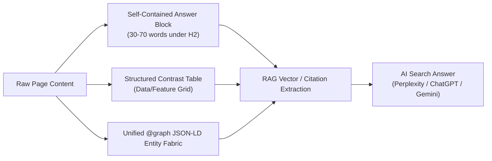

# Content & Discoverability Prime Directive (SEO + GEO 2026)

Every delivered application and website must achieve dual-engine search dominance:
1. **Traditional Algorithmic SEO**: High-ranking SERP placement, technical crawler health, perfect Core Web Vitals, and keyword intent match.
2. **Generative Engine Optimization (GEO)**: Maximum citation share, entity grounding, and zero-click extraction in conversational LLMs (Perplexity, ChatGPT Search, Claude, Google AI Overviews, Gemini).

---

## 1. Brand Extraction & Visual Authenticity

- Extract the REAL brand (logo, colors, typography, voice tone; consult Wayback Machine if source is down). Never invent placeholder brand assets or colors.
- Color derivation: Brand primary derives directly from logo hue-distance analysis. Logo luminance + source theme dictates dark/light mode default.
- Container contrast: Every logo rendering must achieve ≥4.5:1 WCAG contrast against its backdrop. Exactly ONE logo asset per header container.

---

## 2. Anti-AI-Slop Voice (Mandatory Verification)

- **Banned Words**: delve, leverage, unleash, revolutionize, seamless, robust, synergy, elevate, empower, transformative, best-in-class, cutting-edge, discover, innovative, game-changer, tapestry, beacon, testament.
- **Banned Sentence Patterns**:
  - "Welcome to [Platform]..."
  - "In today's fast-paced digital world..."
  - "Discover how [Product] can elevate your..."
  - Vague aspirational headlines with zero concrete nouns.
  - Hedging predicates ("may help", "is designed to potentially").
- **Operator Litmus Test**: *"Would the technical founder or lead architect actually say this to a peer?"* If no → rewrite with active verbs and specific numbers.

---

## 3. Benefit-First High-Velocity Copywriting

- **Headings**: H1 benefit-first, specific, ≤8 words. Subheads 15–25 words explaining the mechanism.
- **Body Rhythm**: One core concept per paragraph. Active voice (>90%). Maximum sentence length 25 words. Flesch Reading Ease ≥60 (Microcopy ≥70).
- **Call-to-Action (CTA)**: Action-verb first, ≤3 words preferred (`Deploy Cluster`, `Start Free`, `Read Spec`). Never use "Click here", "Submit", or "Learn more". Place above the fold and at section terminals.
- **Microcopy**:
  - Errors: State `[What happened]` + `[Exact corrective action]`.
  - Empty states: Explain what will live here + render the primary creation action button.
  - Toasts: Past-tense for completed operations, present participle for background tasks.

---

## 4. Per-Page Technical SEO Architecture

Every public indexable page must satisfy the following checklist before build approval:

### Metadata & Head Elements
- **Title**: 50–60 characters. Format: `{Primary Keyphrase} — {Supporting Value} | {Brand}`. Primary keyphrase within the first 30 characters.
- **Meta Description**: 120–156 characters. Includes the primary keyphrase, a quantifiable benefit, and an action trigger.
- **Canonical URL**: Self-referential lowercase canonical tag (`<link rel="canonical" href="https://example.com/slug" />`). Strip tracking query parameters.
- **OpenGraph & Twitter Cards**:
  - `og:title`, `og:description`, `og:url`, `og:type` (`website` or `article`).
  - `og:image`: High-contrast 1200×630px image with OKLCH brand palette (#060610 background, #00E5FF accent).
  - `twitter:card`: `summary_large_image`.
- **Headings Structure**: Exactly ONE `<h1>` in prerendered HTML. Logical `<h2>` and `<h3>` nesting without skipped levels.

### Core Web Vitals (2026 Standards)
- **Interaction to Next Paint (INP)**: <150ms (strict threshold; eliminate main-thread blocking scripts; CSS-only scroll progress; native `<details>` accordions).
- **Largest Contentful Paint (LCP)**: <1.8s on 4G mobile emulation. Preload hero pictures with `fetchpriority="high"` and AVIF + WebP fallbacks.
- **Cumulative Layout Shift (CLS)**: Exactly 0.00. Explicit CSS `aspect-ratio: 1200 / 630` or `16 / 9` and width/height on all media wrappers before hydration.

---

## 5. Generative Engine Optimization (GEO) & AI Search

Optimizing for LLM retrieval-augmented generation (RAG) and direct citation:



1. **Standalone 30–70 Word Quotable Answer Blocks**: Place a direct, concise answer block immediately under major `<h2>` and `<h3>` question headings. LLMs favor complete, extractable definitions that require no surrounding context.
2. **Tabular Comparison Grids**: Render structured HTML tables with explicit column headers (`✓`, `✗`, numeric benchmarks, pricing tiers). AI models synthesize comparison tables over flowing prose.
3. **Information Gain & Proprietary Data**: Google Core Updates and LLM crawlers heavily reward original data, benchmarks, code samples, and firsthand measurements. Eliminate boilerplate paraphrasing.
4. **Author E-E-A-T Grounding**: Every technical guide or blog post must cite a verifiable author with `Person` JSON-LD schema, `sameAs` links to **ORCID**, **Wikidata**, GitHub, and LinkedIn.
5. **Native HTML Disclosure Primitives**:
   - Render FAQ blocks using native `<details name="faq-group">` exclusive accordions (zero JS overhead, instantly accessible).
   - Use `hidden="until-found"` for collapsed content so in-page text remains search-indexed and Ctrl+F discoverable.
6. **Voice & Audio SEO**:
   - Deploy `SpeakableSpecification` targeting `.tt-lead-paragraph` and `.tt-key-takeaways` so voice assistants and AI summary engines extract spoken snippets.
   - Provide an embedded audio narration player (`<aside class="tt-audio-narration-player">`) linked to an `AudioObject` schema for podcast and audio search discovery.

---

## 6. Type-Safe Schema.org JSON-LD Entities

Structured data removes all semantic ambiguity for both traditional search crawlers and AI agents.

- **Strict Entity Rule**: Only generate JSON-LD for entities that genuinely exist on the page. Never pad empty schemas.
- **Universal Baseline**:
  - `Organization`: Name, URL, Logo, SameAs links, ContactPoint.
  - `WebSite`: Name, URL, PotentialAction (`SearchAction` targeting `/search?q={search_term_string}`).
  - `WebPage`: Name, Description, BreadcrumbList, DatePublished, DateModified.
- **Domain-Specific Types**:
  - `FAQPage`: Strictly paired with visible on-page FAQs.
  - `TechArticle` / `BlogPosting`: Author (`Person`), Publisher (`Organization`), Headline, Image, DateModified.
  - `SoftwareApplication`: ApplicationCategory, OperatingSystem, Offers (`Price`, `PriceCurrency`).
  - `LocalBusiness`: Address (`PostalAddress`), GeoCoordinates, OpeningHoursSpecification, AreaServed.

---

## 7. Editorial Blog Posts & Multimedia Architecture (`@theme.tools/blog`)

Every editorial article, thought-leadership piece, and developer deep-dive must satisfy the Fleet Blog Post Doctrine:

1. **Semantic HTML5 Skeleton**:
   - Encapsulated in `<article class="tt-blog-article">` with max-width 768px.
   - Header containing category pill badge, benefit-first H1, author info, published `<time datetime="...">`, and estimated reading time.
   - Hero picture preloaded with `fetchpriority="high"` in an aspect-ratio bounding box (1200×630).
   - `.tt-lead-paragraph`: Standalone 30–70 word direct answer to search intent.
   - `<aside class="tt-callout tt-callout-key-takeaways">`: Executive summary bulleted grid.
   - `<nav class="tt-toc">`: Hierarchical Table of Contents with deep anchor links.
   - `<main class="tt-article-body">`: Structured body with tables, interactive code blocks, and media.
   - Native `<details name="blog-faq">` exclusive accordions for FAQs.
   - `<footer class="tt-citations-footer">`: Numbered primary source citations (`rel="noopener noreferrer" target="_blank"`).

2. **Zero Layout Shift (CLS = 0) Multimedia**:
   - **Responsive Pictures**: `<picture>` with AVIF + WebP sources, explicit `width`, `height`, and inline CSS `aspect-ratio` bounding box.
   - **Cloudflare Stream Video**: Responsive 16:9 wrapper paired with `VideoObject` Schema.org JSON-LD and collapsible transcript in `<details class="tt-video-transcript">`.
   - **Interactive Code Blocks**: Filename header, language badge, and accessible contrast on deep space canvas (`#060610`).

3. **Complete JSON-LD Schema (`BlogPosting` / `TechArticle`)**:
   - `headline`, `description`, `image`, `datePublished`, `dateModified`.
   - `author`: `Person` with `name`, `jobTitle`, `url`, and `sameAs` entity links.
   - `publisher`: `Organization` with `name` and `logo`.
   - `speakable`: CSS selectors for voice assistants (`.tt-lead-paragraph`, `.tt-key-takeaways`).
   - `citation`: Array of verifiable primary reference URLs.
   - `hasPart`: Video chapter Key Moments clips.

4. **Programmatic Validation**:
   Audit any article before publish:
   ```bash
   node ~/.agentskills/bin/blog-post-validator.ts --file path/to/article.html
   ```

---

## 8. Machine-Readable AI Manifests: `llms.txt` & `llms-full.txt`

In addition to human-facing pages, provide clean, token-efficient Markdown manifests for AI agents and coding tools:

- **`/llms.txt`**: Standardized Markdown table of contents at the domain root:
  ```markdown
  # Project / Company Name
  > One-sentence mission statement and technical summary.

  ## Core Documentation
  - [Architecture](/docs/architecture.md): System architecture and data flow.
  - [API Reference](/docs/api.md): Endpoints, authentication, and schemas.
  ```
- **`/llms-full.txt`**: Comprehensive single-file Markdown bundle aggregating all core technical documentation for single-fetch agent ingestion.

---

## 9. Automated Crawl Directives & Instant Indexing

### Robots.txt AI Policy
Explicitly declare permissions for legitimate AI search engines while maintaining control over training scrapers:
```txt
User-agent: *
Allow: /
Disallow: /api/
Disallow: /private/

User-agent: GPTBot
Allow: /

User-agent: ClaudeBot
Allow: /

User-agent: PerplexityBot
Allow: /

User-agent: Google-Extended
Allow: /

Sitemap: https://example.com/sitemap.xml
```

### Instant Search Indexing via IndexNow
- Expose the verification key at `/{INDEXNOW_KEY}.txt`.
- Trigger automated POST pings to `https://api.indexnow.org/indexnow` upon page publication or deployment.
- Sync with Cloudflare Crawler Hints to immediately notify Bing, Yandex, Naver, and Seznam.

---

## 10. Programmatic SEO (pSEO) Quality Gates & Anti-Abuse Architecture

Scalable programmatic page generation (e.g. `{Integration} × {Use-Case}`, `{Currency} Live Spreads & Settlement Rates`) must strictly satisfy the **7 Programmatic Quality Gates** (`rules/programmatic-seo-doctrine.md`) to prevent algorithmic devaluation under Google's Scaled Content Abuse policy:

1. **Proprietary Data Depth**: Every programmatic page must be anchored by a database row with $\ge 4$ unique factual, numeric, or benchmark attributes (`pricing`, `latencyMs`, `marketDepth`, `uptime`). "Keyword-swapping" boilerplate prose without unique data is strictly prohibited.
2. **Information Gain Ratio**: Document vocabulary dissimilarity (Jaccard distance) between any two programmatic instances must be $\ge 35\%$.
3. **Interactive Utility Component**: Every page must mount at least one functional tool, calculator, live comparison matrix, or real-time SVG chart (not static text alone).
4. **Structured Contrast Grid**: Render an entity-level comparison table with explicit benchmark metrics.
5. **Schema Parity**: Deploy domain-specific structured data (`Dataset`, `SoftwareApplication`, `Table`, `FAQPage`) reflecting real data fields.
6. **Hub-and-Spoke Semantic Architecture**: Strict bidirectional hierarchy (Directory Index $\leftrightarrow$ Sub-hub $\leftrightarrow$ Programmatic Leaf). Zero orphan leaves.
7. **Automated Batch Verification**:
   ```bash
   node ~/.agentskills/bin/pseo-quality-gate.ts --dataset=path/to/pseo-dataset.json
   ```

---

## 11. Internationalization & Multilingual Hreflang Canonical Architecture

For cross-border reach across global markets, implement Google & Bing compliant multilingual canonicalization via `@theme.tools/seo-geo`:

1. **ISO-639-1 & ISO-3166-1 Strict Tagging**: Use valid 2-letter language codes (`en`, `es`, `ja`) or language-country combinations (`en-US`, `es-MX`).
2. **Mandatory Self-Referencing Tag**: Every localized variant must include an `<link rel="alternate" hreflang="..." href="...">` pointing to itself.
3. **Mandatory `x-default` Fallback**: Always designate a language-agnostic international selector page or default locale (typically English root) as `hreflang="x-default"`.
4. **Reciprocal Bidirectional Links**: If Page A in Spanish declares Page B in English as an alternate, Page B MUST declare Page A in Spanish as an alternate. Unidirectional links are dropped by search engines.
5. **Automated Verification**:
   ```bash
   node ~/.agentskills/bin/hreflang-auditor.ts --manifest path/to/locales.json
   ```

---

## 12. Edge Dynamic SEO & HTML Rewriting (Sub-2ms Overhead)

Leverage Cloudflare Workers and `@theme.tools/seo-geo` (`transformHtmlForEdgeSeo`) to inject real-time OpenGraph tags, canonicals, and Schema.org JSON-LD at the edge before content reaches the crawler:

```typescript
import { transformHtmlForEdgeSeo } from '@theme.tools/seo-geo';

export default {
  async fetch(request: Request, env: Env): Promise<Response> {
    const response = await fetch(request);
    const html = await response.text();

    const transformedHtml = transformHtmlForEdgeSeo(html, {
      title: 'Real-Time Pricing & Latency | SwarmLink',
      description: 'Zero-latency multi-agent orchestration infrastructure.',
      canonicalUrl: new URL(request.url).pathname,
      ogImageUrl: 'https://swarml.ink/og/live-metrics.png',
      schemaJsonLd: [
        {
          '@context': 'https://schema.org',
          '@type': 'TechArticle',
          headline: 'Real-Time Pricing & Latency',
        },
      ],
    });

    return new Response(transformedHtml, {
      headers: response.headers,
    });
  },
};
```

---

## 13. Automated Pre-Flight SEO & GEO Verification Gate

No website or web service may be deployed without passing the automated audit suite:
```bash
# 1. Full-Site SEO & GEO Health
node ~/.agentskills/bin/seo-auditor.ts --url https://example.com

# 2. Editorial Blog Post & Multimedia Standard (100/100 required)
node ~/.agentskills/bin/blog-post-validator.ts --file path/to/article.html

# 3. Programmatic SEO Quality Gates
node ~/.agentskills/bin/pseo-quality-gate.ts --dataset path/to/dataset.json

# 4. Multilingual Hreflang Canonical Auditor
node ~/.agentskills/bin/hreflang-auditor.ts --manifest path/to/manifest.json
```
Must pass 100% of checks:
- Title (50–60 chars) & Meta Description (120–156 chars) present.
- Exactly one `<h1>` tag in static SSR HTML.
- Valid JSON-LD Schema without parse errors.
- Dynamic 1200×630 OG image returns HTTP 200.
- `robots.txt`, `sitemap.xml`, and `llms.txt` return HTTP 200.
- Zero broken internal `<a>` links.
- Image `alt` tags present on all informative images.
- Information gain score $\ge 35\%$ and zero ungrounded paraphrased slop.
