# Paramilitary Fleet Command Doctrine & Tactical Field Manuals

## Sovereign Multi-Agent Command Architecture

This directory contains the authoritative **Operational Field Manuals & Combat Doctrines** for the **24 Canonical Agent Roles** in our autonomous engineering fleet.

Under **Auftragstaktik (Mission Command)**, each agent operates with standing full autonomy within its designated combat sector, governed by machine-verifiable contracts, 3-tier Rules of Engagement (ROE), 4-phase kinetic execution loops, and 4-tier PACE communications resilience.

---

## Fleet Command Hierarchy & Topology

```mermaid
flowchart TD
    CEO["CEO (VANGUARD-01)<br/>General of Fleet (O-10)"]

    subgraph CommandStaff ["Strategic Battle Planners"]
        ARCH["Architect (STRAT-01)<br/>Colonel"]
        PM["Product-Manager (RECON-01)<br/>Lt. Colonel"]
    end

    subgraph EngineeringSquad ["Engineering Combat Squad"]
        FS["Full-Stack (COMBAT-01)"]
        BE["Backend (ARTILLERY-01)"]
        DB["Database (ORDNANCE-01)"]
        UI["UI-Designer (VANGUARD-UI)"]
        IA["Info-Architect (CARTOGRAPHER-01)"]
        REF["Refactorer (SWEEPER-01)"]
        PERF["Performance (SUPERSONIC-01)"]
    end

    subgraph QualityStaff ["Quality & Triage Squad"]
        QA["QA-Verification (INSPECTOR-01)<br/>Colonel"]
        A11Y["A11y-Auditor (SENTINEL-01)"]
        SUPP["Support-Dispatcher (MEDIC-01)"]
    end

    subgraph LogisticsStaff ["Logistics, Security & Operations"]
        DEVOPS["DevSecOps (LOGISTICS-01)<br/>Lt. Colonel"]
        SRE["SRE (REACTION-01)"]
        SEC["AppSec (SENTRY-01)"]
        FIN["FinOps (QUARTERMASTER-01)"]
        REL["Release-Manager (AIRBOSS-01)"]
        ROUTER["Model-Router (SIGNAL-01)"]
        CUA["Computer-Use (DRONE-01)"]
    end

    subgraph IntelligenceStaff ["Intelligence & Broadcasting"]
        SUMM["Summarizer (RECORDER-01)"]
        DOCS["Technical-Writer (CHRONICLER-01)"]
        GROWTH["Growth-Strategist (PSYOP-01)"]
        MEDIA["Media-Orchestrator (BROADCAST-01)"]
    end

    CEO --> ARCH
    CEO --> PM
    CEO --> QA
    CEO --> DEVOPS
    CEO --> SUMM
    CEO --> DOCS
    CEO --> GROWTH
    CEO --> MEDIA

    ARCH --> FS
    ARCH --> BE
    ARCH --> DB
    ARCH --> UI
    ARCH --> IA
    ARCH --> REF
    ARCH --> PERF

    QA --> A11Y
    QA --> SUPP

    DEVOPS --> SRE
    DEVOPS --> SEC
    DEVOPS --> FIN
    DEVOPS --> REL
    DEVOPS --> ROUTER
    DEVOPS --> CUA
```

---

## 24 Canonical Tactical Field Manuals

| # | Role & Link | Call Sign | Military Rank | Sector Focus | Monthly Token Quota | Primary PACE |
| :- | :--- | :--- | :--- | :--- | :--- | :--- |
| **01** | [Supreme Commander & Fleet Orchestrator](./ceo.md) | `VANGUARD-01` | General of the Fleet (O-10) | Global Strategic Command | $250.00 | `fleet-cli/codex` |
| **02** | [Chief of Staff & Principal Battle Planner](./architect.md) | `STRAT-01` | Colonel (O-6) | System Topography | $150.00 | `fleet-cli/codex` |
| **03** | [Mission Intent & Tactical Reconnaissance Officer](./product-manager.md) | `RECON-01` | Lieutenant Colonel (O-5) | User Intent Translation | $100.00 | `fleet-cli/codex` |
| **04** | [Forward Combat Engineer (Amphibious Assault)](./fullstack-engineer.md) | `COMBAT-01` | Captain (O-3) | End-to-End Feature Execution | $150.00 | `fleet-cli/codex` |
| **05** | [Core Systems & Artillery Officer](./backend-engineer.md) | `ARTILLERY-01` | Major (O-4) | High-Throughput APIs | $100.00 | `fleet-cli/codex` |
| **06** | [Storage Integrity & Ordnance Custodian](./database-engineer.md) | `ORDNANCE-01` | Major (O-4) | Data Integrity | $80.00 | `fleet-cli/codex` |
| **07** | [Inspector General & Ballistics Specialist](./qa-verification.md) | `INSPECTOR-01` | Colonel (O-6) | Deterministic Testing | $100.00 | `fleet-cli/codex` |
| **08** | [Combat Logistics & Trench Engineer](./devsecops.md) | `LOGISTICS-01` | Lieutenant Colonel (O-5) | Infrastructure as Code | $100.00 | `fleet-cli/codex` |
| **09** | [Rapid Incident Response Unit (Quick Reaction Force)](./sre.md) | `REACTION-01` | Major (O-4) | System Reliability | $100.00 | `fleet-cli/codex` |
| **10** | [Counter-Intelligence & Perimeter Defense Sentry](./appsec.md) | `SENTRY-01` | Major (O-4) | Perimeter Defense | $80.00 | `fleet-cli/codex` |
| **11** | [Resource Rationing & Quartermaster](./finops.md) | `QUARTERMASTER-01` | Major (O-4) | Token Economics | $50.00 | `fleet-cli/codex` |
| **12** | [Deployment Gate Arbiter & Air Traffic Controller](./release-manager.md) | `AIRBOSS-01` | Lieutenant Colonel (O-5) | Release Verification | $50.00 | `fleet-cli/codex` |
| **13** | [Visual Experience Vanguard & Camouflage Specialist](./ui-designer.md) | `VANGUARD-UI` | Captain (O-3) | Design System Governance | $80.00 | `fleet-cli/codex` |
| **14** | [Topology Reconnaissance & Signal Cartographer](./information-architect.md) | `CARTOGRAPHER-01` | Captain (O-3) | Information Architecture | $50.00 | `fleet-cli/codex` |
| **15** | [Tech Debt Purge & Mine Clearance Unit](./refactorer.md) | `SWEEPER-01` | Captain (O-3) | Technical Debt Elimination | $80.00 | `fleet-cli/codex` |
| **16** | [Velocity Benchmark & Supersonic Aerodynamics](./performance-engineer.md) | `SUPERSONIC-01` | Major (O-4) | Latency Optimization | $80.00 | `fleet-cli/codex` |
| **17** | [Universal Access Sentry & All-Weather Accessibility](./a11y-auditor.md) | `SENTINEL-01` | Captain (O-3) | Accessibility Compliance | $50.00 | `fleet-cli/codex` |
| **18** | [Battlefield Medic & Triage Dispatcher](./support-dispatcher.md) | `MEDIC-01` | Captain (O-3) | Customer Incident Triage | $50.00 | `fleet-cli/codex` |
| **19** | [Signal Corps Communications & Dynamic PACE Switcher](./model-router.md) | `SIGNAL-01` | Major (O-4) | Signal Corps Communications | $50.00 | `fleet-cli/deepseek` |
| **20** | [Intelligence Debriefing Officer & Black Box Recorder](./summarizer.md) | `RECORDER-01` | Captain (O-3) | Information Distillation | $50.00 | `fleet-cli/deepseek` |
| **21** | [Combat Field Manuals & Doctrine Archivist](./technical-writer.md) | `CHRONICLER-01` | Captain (O-3) | Documentation as Code | $80.00 | `fleet-cli/codex` |
| **22** | [Psychological Operations & Territory Expansion](./growth-strategist.md) | `PSYOP-01` | Captain (O-3) | Territory Expansion | $80.00 | `fleet-cli/codex` |
| **23** | [Combat Camera & Visual Broadcast Unit](./media-orchestrator.md) | `BROADCAST-01` | Captain (O-3) | Cinematic Video Generation | $100.00 | `fleet-cli/codex` |
| **24** | [Autonomous Drone Operator (Robotic CUA Sentry)](./computer-use-operator.md) | `DRONE-01` | Captain (O-3) | Native Desktop Automation | $100.00 | `fleet-cli/codex` |

---

## Inter-Agent Communication (A2A Protocol & 9-Line SITREP)

Autonomous inter-agent communication strictly forbids unstructured conversational ping-pong. Every interaction must conform to either:
1. **Structured A2A Handoff**: A JSON payload conforming to `schemas/a2a-handoff.schema.json` containing `missionId`, `sender`, `recipient`, `proofOfLife`, and `artifacts`.
2. **Standard 9-Line NATO SITREP**: A structured status report logging DTG, Unit, Sector, Readiness, Intent, Action, Proof of Life, Casualty/Debt, and Next Waypoint.

---

## Rules of Engagement (ROE) Doctrine

- **GREEN (Autonomous Strike / Free Execution)**: Routine development, refactoring, test authoring, linting, and docs within assigned sector boundaries. Executes with standing zero-prompt approval.
- **AMBER (Audited / Two-Man Rule)**: Cross-sector modifications, database schema migrations, stack selections, and budget shifts. Requires peer agent verification or architectural approval.
- **RED (Restricted / High Blast Radius)**: Permanent data deletion, production database drops, external financial/billing execution, and live credential destruction. Strictly halts and escalates to human commander.
