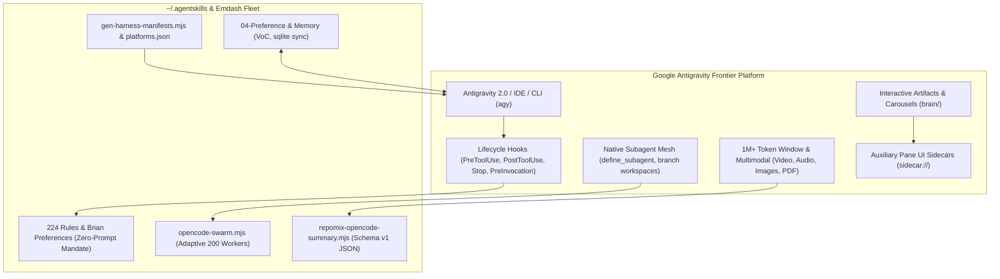
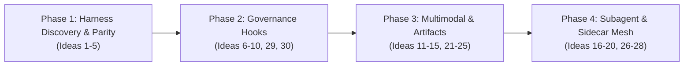

# Gemini / Antigravity Integration Audit & 30 Brilliant Improvements

> **System Audit Scope**: 263 Agent Skills, 224 Doctrine Rules, Brian's Preferences (`rules/brian-preferences.md`), Antigravity Customization Architecture (`agy-customizations`), Antigravity CLI/IDE/2.0 (`antigravity_guide`), and OpenCode/DeepSeek Swarm Fabric (`rules/agent-provider-policy.md`).

---

## Executive Summary & Audit Findings

The Agent Skills ecosystem (`~/.agentskills`) is a world-class autonomous software engineering harness containing 263 specialized skills, 224 doctrine rules, and sophisticated multi-agent orchestration. However, the audit reveals a significant platform asymmetry:

```
Skills mentioning Claude:       151
Skills mentioning OpenAI Codex:  74
Skills mentioning Gemini:        15
Skills mentioning Antigravity:    2
Platform manifests generated:   Codex, OpenCode, Kimi (Antigravity is omitted)
Memory backend (Skill 04):      Hardcoded to ~/.claude/projects/
```

Despite Gemini 3.8 / Pro offering a **1,000,000+ token context window**, **native multimodal perception** (direct video, audio, image, and PDF ingestion), **dynamic in-turn subagents** (`flash_lite` / `flash` / `pro` with branched workspaces), **reactive wakeup messaging**, **lifecycle hooks** (`PreInvocation`, `PostInvocation`, `PreToolUse`, `PostToolUse`, `Stop`), **rich interactive Artifacts**, and **Electron UI sidecars**, the skills layer currently treats Gemini as a text-only, single-file prompt recipient (`GEMINI.md`).

The following **30 brilliant improvements** unlock the full power of Gemini and Antigravity, elevating Antigravity from an external CLI client to a first-class, frontier parent orchestrator.

---



---

## 1. Harness Discovery, Manifest Generation & Multi-Platform Parity

### 1. `gen-antigravity-harness.mjs` & `platforms.json` Registration
* **Finding**: `platforms.json` only tracks `"gemini-md" -> "GEMINI.md"`. `bin/gen-harness-manifests.mjs` generates manifests for Codex (`.codex-plugin`), OpenCode (`.opencode`), and Kimi (`.kimi-plugin`), but completely omits Antigravity.
* **Brilliant Idea**: Register `antigravity-plugin` in `platforms.json` and extend `gen-harness-manifests.mjs` to auto-emit `.agents/plugins/agentskills/plugin.json`, `skills.json`, and `mcp_config.json`. This enables Antigravity to discover all 263 skills natively with progressive disclosure, zero config, and version pinning.

### 2. Global Antigravity Config & Symlink Fabric (`~/.gemini/config/`)
* **Finding**: Antigravity natively loads global customizations from `~/.gemini/config/` (plugins, skills, sidecars). Currently, `~/.gemini/config/plugins/` only has a bare Emdash hook stub.
* **Brilliant Idea**: Create an automated setup script (`bin/setup-antigravity-global.sh`) that establishes symlinked plugins under `~/.gemini/config/plugins/agentskills/`, exposing the core 224 rules as `rules/AGENTS.md` and mounting high-frequency skill categories (`01`, `05`, `06`, `07`, `08`) across all workspaces automatically.

### 3. Dual-Stack Universal Memory Bridge (`04-preference-and-memory`)
* **Finding**: `04-preference-and-memory/SKILL.md` hardcodes memory storage to `~/.claude/projects/<encoded-path>/memory/`. Antigravity's brain artifacts and `conversation_summaries.db` are completely disconnected.
* **Brilliant Idea**: Upgrade `04-preference-and-memory` to maintain a unified, harness-neutral memory directory (`~/.agentskills/memory/` or `.agents/memory/`) with two-way sync. Build a converter that indexes Antigravity's SQLite summaries (`~/.gemini/antigravity-cli/conversation_summaries.db`) into Voice of the Customer (VoC) feedback signals.

### 4. Antigravity Slash Command Registry Bridge
* **Finding**: Antigravity has native slash commands (`/goal`, `/plan`, `/boost`, `/learn`, `/compact`, `/teamwork`, `/browser`, `/grill-me`, `/schedule`). Skills define slash commands in `commands/` that are mapped to Claude.
* **Brilliant Idea**: Map Antigravity's native slash commands directly to Agent Skills doctrines:
  - `/goal` $\rightarrow$ `rules/autonomous-engineering.md` (unattended run-to-completion)
  - `/boost` $\rightarrow$ `rules/ideal-architecture-loop.md` (multi-perspective critique)
  - `/learn` $\rightarrow$ `04-preference-and-memory` (instant VoC capture to durable layer)
  - `/teamwork` $\rightarrow$ `rules/parallel-subagent-economy.md` (subagent mesh activation)

### 5. Project Scaffolding Auto-Injection (`.agents/` alongside `.claude/`)
* **Finding**: Workspaces like `swarml.ink` contain `.claude/` with `scheduled_tasks.json` and `run-the-loop`, but zero Antigravity `.agents/` or `.gemini/` configuration.
* **Brilliant Idea**: Update `05-architecture-and-stack` project templates and `bin/sync-mirrors.mjs` to scaffold `.agents/` containing `GEMINI.md`, `skills.json`, and project-scoped hooks whenever an Emdash repository is initialized or synced, establishing instantaneous dual-harness parity.

---

## 2. Lifecycle Hooks for Autonomous Governance & Zero-Prompt Mandate

### 6. The "Never Stop Early" `Stop` Lifecycle Hook
* **Finding**: Antigravity execution terminates on `NO_TOOL_CALL`. Models occasionally stop prematurely before running tests or deploying changes, violating Brian's doctrine ("Never stop early", "Deploy = build + deploy + push").
* **Brilliant Idea**: Deploy a native Antigravity `Stop` hook (`hooks.json`) that inspects the workspace before allowing the agent to exit:
  ```json
  {
    "autonomous-completion-guard": {
      "Stop": [{
        "type": "command",
        "command": "node ~/.agentskills/bin/antigravity-stop-guard.mjs",
        "timeout": 15
      }]
    }
  }
  ```
  If git has uncommitted changes, unrun Playwright tests, or undeployed commits on a green build, the hook outputs `{"decision": "continue", "reason": "Verification gate not satisfied: tests unrun and changes undeployed. Complete the verification loop."}`. The agent cannot stop until fully done.

### 7. PreToolUse Autonomous Safety Gate & Zero-Prompt Enforcer
* **Finding**: The Zero-Prompt Mandate requires Antigravity to never prompt the user except for deliberate skill interviews or genuinely dangerous actions (dropping tables, mass customer mutations).
* **Brilliant Idea**: Implement a `PreToolUse` hook on `run_command` and file tools:
  - Automatically returns `{"decision": "allow"}` for all standard engineering commands (`git commit`, `git push`, `npm test`, `wrangler deploy`, edits, builds).
  - Intercepts destructive patterns (e.g. `DROP TABLE`, `rm -rf /`, bulk stripe mutations) and returns `{"decision": "force_ask", "reason": "Destructive production mutation detected"}`.
  - Eliminates accidental UI permission prompts, enforcing 100% autonomous throughput.

### 8. PreToolUse Language Guardrail (Bash & TS Enforcement)
* **Finding**: Brian's 2026-10-31 mandate strictly dictates: TypeScript for apps/services/CLIs; Bash for system scripts/glue/cron. *"Python is NOT a default... catch yourself writing `*.py` for system work $\rightarrow$ rewrite in Bash."*
* **Brilliant Idea**: A `PreToolUse` hook matching `write_file`, `edit_file`, and `run_command`:
  - When the agent attempts to create or execute a new `*.py` script in a system/glue path (excluding genuine ML/data libraries), the hook rejects or overwrites with a notice: `Hook Notice: Brian preference violation: system glue must be written in Bash (or TypeScript). Python is reserved for ML/data.`
  - Mechanically enforces language preferences at the tool execution boundary.

### 9. PreInvocation 900K Context Hydration Hook
* **Finding**: Rule `rules/context-hydration.md` requires up to 900K tokens of relevant source, exact contracts, and fully loaded skills before substantial work. Currently, this relies on manual multi-turn grepping.
* **Brilliant Idea**: A `PreInvocation` hook that analyzes `lastUserInput` and git status on turn 1:
  - Invokes `bin/skill-router.py` to identify relevant skills and schemas.
  - Synthesizes exact contracts and tests into an evidence bundle.
  - Injects via `injectSteps: [{"systemMessage": {"systemMessage": "<hydrated-evidence-pack>"}}]`.
  - The model starts Turn 1 with complete 900K working context without spending any output tokens on retrieval.

### 10. PostToolUse Auto-Format & Syntax Verification Hook
* **Finding**: Syntax errors or formatting deviations in edits require follow-up model turns to fix.
* **Brilliant Idea**: Implement a `PostToolUse` hook matching `edit_file` and `write_file`:
  - Automatically runs `prettier --write` or `biome check --apply` on modified files immediately.
  - Runs quick syntax/type checks (`tsc --noEmit --isolatedModules`).
  - If a fatal syntax error was introduced, it feeds the compiler diagnostic into the next turn immediately, allowing the agent to self-heal in a single sub-turn.

---

## 3. Native Multimodal Superpowers (Images, Video, Audio, PDFs)

### 11. Multimodal Native Visual Inspection Loop (`07-quality-and-verification`)
* **Finding**: Current skills shell out to external scripts (`gpt4o-vision-analyze.sh`) to review screenshots because Claude CLI historically lacked native image tool inputs in certain environments.
* **Brilliant Idea**: Antigravity's `read_file` natively ingests images. Rewrite `visual-inspection-loop` and `evidence-collection` to pass Playwright viewport screenshots directly to Gemini:
  - Gemini 3.8 natively checks layout alignment, mobile responsiveness, typography hierarchy, and dark-first palette adherence (`#060610` background, `#00E5FF` cyan accent).
  - Eliminates external curl scripts and API billing, using Antigravity's native multimodal engine.

### 12. HyperFrames Video QA & Render Audit
* **Finding**: `hyperframes`, `hyperframes-cli`, and `remotion-to-hyperframes` render animations and videos to WebM/MP4, then guess quality or inspect raw HTML.
* **Brilliant Idea**: Feed the rendered MP4/WebM video file directly to Gemini using `read_file`:
  - Gemini's native video comprehension scans frame-by-frame for animation stutter, typography cutoffs, layout popping, and transition glitches.
  - Direct frame-accurate feedback loop without requiring ffmpeg frame extraction.

### 13. Audio-Video Cadence & Lip-Sync Verification
* **Finding**: Skills `audio-video-sync` and `picovoice-eagle-biometric` require specialized local binaries to verify audio tracks, speech alignment, and music beats.
* **Brilliant Idea**: Antigravity's `read_file` supports native audio files (MP3, WAV, AAC). Pass both the audio track and video render to Gemini:
  - Gemini evaluates audio cadence, voiceover clarity, background music ducking, and beat-drop alignment against visual scene transitions in music videos and launch films.

### 14. PDF Spec & Design System Direct Ingestion
* **Finding**: Architecture planning (`02-goal-and-brief`, `05-architecture-and-stack`) often receives client specs, API documentation, or wireframes in PDF format, previously requiring `pdftotext` which strips diagrams.
* **Brilliant Idea**: Direct PDF reading via `read_file`:
  - Gemini extracts spatial layout, ER diagrams, flowchart arrows, and table layouts from PDF specifications, converting client visual architectures directly into Drizzle ORM schemas and Hono endpoints.

### 15. Multimodal WCAG AAA Contrast & Asset Polish Auditing
* **Finding**: Text contrast rules (`rules/text-contrast.md`, `rules/logo-contrast.md`) test calculated CSS color values, which fail to detect text over background gradients, WebGL canvases, or hero video overlays.
* **Brilliant Idea**: Feed full-page rendered screenshots to Gemini to evaluate human-perceived contrast over complex visual backgrounds (canvas shaders, particle effects, hero overlays), guaranteeing strict WCAG 2.2 AAA readability.

---

## 4. Native Dynamic Subagents & Swarm Orchestration

### 16. Dynamic `define_subagent` Autonomous Specialist Factory
* **Finding**: Claude relies on external bash sub-processes or tmux sessions. Antigravity has native in-session agent definition: `define_subagent` and `invoke_subagent`.
* **Brilliant Idea**: Create an automated Antigravity specialist registry that defines dynamic subagent personas on Turn 1:
  - `tdd-implementer`: Dedicated unit/component TDD builder with write tools.
  - `security-auditor`: Read-only semgrep/secret scanner.
  - `visual-qa`: Multimodal Playwright screenshot inspector.
  - Each specialist runs in its own conversation context, preventing context dilution in the parent orchestrator.

### 17. Intelligent Model Tiering (`flash_lite` vs `flash` vs `pro`)
* **Finding**: Running frontier models on trivial file searches or test runs is wasteful, but running small models on deep architecture results in flaws.
* **Brilliant Idea**: Codify model selection in `invoke_subagent`:
  - `flash_lite`: File search, syntax audits, formatting, changelog updates (sub-second execution).
  - `flash`: Routine feature slicing, component implementation, unit tests.
  - `pro`: Hard debugging, security audits, database migration planning, final architectural convergence.
  - Yields $5\times$ wall-clock speedups while keeping intelligence concentrated where it matters.

### 18. Worktree-Isolated Subagent Execution (`Workspace: "branch" | "share"`)
* **Finding**: `rules/parallel-subagent-economy.md` requires disjoint worktrees to prevent write collisions. Claude subagents require manual git worktree scripts.
* **Brilliant Idea**: Antigravity natively supports `Workspace: "branch"` and `Workspace: "share"` in `invoke_subagent`:
  - Branching spawns an isolated filesystem clone automatically.
  - Up to 4 parallel feature specialists work simultaneously on separate branches without file contention.
  - The parent orchestrator merges and integrates the green branches cleanly.

### 19. OpenCode Swarm / Antigravity Hybrid Mesh
* **Finding**: `rules/agent-provider-policy.md` mandates offloading routine work to `opencode-swarm.mjs` (up to 200 DeepSeek workers). Antigravity currently lacks a native bridge to monitor and fold swarm tasks.
* **Brilliant Idea**: Build an Antigravity wrapper tool / command `bin/agy-swarm-fold.mjs`:
  - Dispatches disjoint tasks to `opencode-swarm.mjs`.
  - Runs in background (`run_command` with `IsDaemon: true`).
  - Upon completion, parses the schema-validated JSON results and injects an integrated diff report directly into Antigravity's parent context for immediate verification.

### 20. Reactive Subagent Wakeup Loop (Zero Polling, Zero Spin)
* **Finding**: Many autonomous loops use shell sleep loops (`while sleep 5; do ... done`), wasting CPU and violating Antigravity instructions ("never use a shell sleep command as a timer").
* **Brilliant Idea**: Fully adopt Antigravity's **Reactive Wakeup** system:
  - Subagents and background tasks notify the parent agent upon completion.
  - The parent simply halts tool execution and sleeps; Antigravity wakes the agent automatically when results arrive.
  - Completely eliminates token burns and process churn from polling.

---

## 5. Rich Artifacts, Carousels & Interactive Dashboards

### 21. Interactive OpenSpec Proposals with `RequestFeedback` Proceed Gate
* **Finding**: Every durable repository mutation requires OpenSpec; architectural work also retains explicit user gates where required (Figma designs, destructive schema migrations).
* **Brilliant Idea**: Render OpenSpec change proposals directly as Antigravity Artifacts in `<appDataDir>/brain/<conversation-id>/`:
  ```markdown
  ArtifactMetadata: {
    Summary: "OpenSpec proposal for multi-tenant auth and D1 migrations",
    UserFacing: true,
    RequestFeedback: true
  }
  ```
  Antigravity renders an interactive "Proceed" button in the UI. Brian can approve the plan with a single click, satisfying the formal gate while preserving the Zero-Prompt Mandate.

### 22. Carousel Code Progressions & Before/After Architectural Diffs
* **Finding**: Reviewing multi-file refactors in markdown terminal output is overwhelming and clutters conversation history.
* **Brilliant Idea**: Use Antigravity's native ````carousel syntax with `<!-- slide -->` in refactoring skills (`06-build-and-slice-loop`):
  - Slide 1: Original architecture / legacy code.
  - Slide 2: Refactored clean TypeScript drop-in.
  - Slide 3: Unit test coverage & assertion results.
  - Slide 4: Bundle size and performance comparison.
  - Clean, carousel-based visual review without scrolling through walls of text.

### 23. Mermaid System Topology & State Machine Rendering
* **Finding**: Skills in `05-architecture-and-stack` describe complex Cloudflare Worker, Durable Object, and Queue topologies in plain text.
* **Brilliant Idea**: Standardize Mermaid output in all architecture artifacts:
  - Worker $\leftrightarrow$ Durable Object $\leftrightarrow$ D1 flows rendered via `flowchart LR`.
  - Authentication lifecycle and Better-Auth sessions rendered via `sequenceDiagram`.
  - Background workflow states rendered via `stateDiagram-v2`.
  - Antigravity's UI natively renders these into interactive visual diagrams.

### 24. Live Verification Dashboard Artifact (`07-quality-and-verification`)
* **Finding**: Verification outputs (test runs, lint checks, build outputs, bundle sizes) are scattered across turns.
* **Brilliant Idea**: Maintain a persistent `verification-dashboard.md` artifact updated in-place across the session:
  - Tracks Playwright test suites (Desktop, Mobile, Tablet).
  - Displays Lighthouse metrics (TTFR, LCP, CLS).
  - Live deployment URLs and CDN cache purge status.
  - Single source of truth for repository health during long runs.

### 25. Persistent Scratch Protocol (`brain/<id>/scratch/`)
* **Finding**: Temporary scripts, test data, and curl test payloads often litter the project root or `/tmp/` (violating `rules/repo-folder-hygiene.md`).
* **Brilliant Idea**: Mandate all intermediate debugging scripts, sqlite dumps, and test harnesses be stored in Antigravity's dedicated scratchpad: `<appDataDir>/brain/<conversation-id>/scratch/`:
  - Persisted across session restarts.
  - Zero pollution in git repositories.
  - Accessible to all subagents in the conversation tree.

---

## 6. Sidecars, UI Panes & Continuous Background Automation

### 26. Emdash Auxiliary Pane Sidecar (`has_web_ui: true`, `sidecar://`)
* **Finding**: Antigravity 2.0 features an HTML Auxiliary Pane capable of docking custom web UIs via sidecars (`~/.gemini/config/sidecars/<id>/sidecar.json`).
* **Brilliant Idea**: Create the **Emdash Fleet Sidecar**:
  - A lightweight React/Vite web application docked into the Antigravity UI.
  - Displays live Cloudflare Worker status, active OpenCode DeepSeek workers, recent D1 database migrations, and pending scheduled tasks.
  - Links in agent responses using `[View Fleet Dashboard](sidecar://emdash-fleet/)` open the sidecar view instantly.

### 27. Native `schedule` Background Autonomous Monitoring
* **Finding**: Scheduled tasks in `.claude/scheduled_tasks.json` rely on custom bash daemons and cron wrappers.
* **Brilliant Idea**: Transition continuous monitors to Antigravity's native `schedule` tool:
  - Schedule recurring health checks (`CronExpression: "*/10 * * * *"`, `IsDaemon: true`).
  - Schedule delayed deployment verification (`DurationSeconds: 120`, `TimerCondition: "any"`).
  - The system triggers reactive agent notifications when attention is needed, eliminating background bash polling scripts.

### 28. Repomix Context Compiler Cache Sidecar
* **Finding**: Running Repomix on large repositories can take 10-20 seconds if executed synchronously during a turn.
* **Brilliant Idea**: A lightweight file-watcher sidecar running in the workspace that incrementally updates `.agent/context-summary.json` conforming to `repomix-context-summary.v1.schema.json`. When Antigravity needs whole-repository context, the schema-validated JSON summary is available in $<10\text{ms}$.

### 29. Autonomous Git Push & Cloudflare Deploy Pipeline
* **Finding**: Brian's directive (2026-06-19) requires: *"ALWAYS auto-push — never hold work, never emit NEEDS BRIAN for a git push... Deploy = build + wrangler deploy + push, autonomously."*
* **Brilliant Idea**: Build an automated convergence pipeline script `bin/agy-ship-it.sh` triggered on gate completion:
  - Runs `git commit` with conventional message and immediate `git push`.
  - Runs `wrangler deploy` to production Cloudflare Workers.
  - Purges Cloudflare CDN cache via API.
  - Verifies live health endpoint with curl.
  - Documents live URL and commit hash in the final turn summary.

### 30. "Prompt-as-Training-Signal" Auto-Extraction Engine
* **Finding**: Rule `rules/prompt-as-training-signal.md` states: *"Every prompt is a gradient... Extract lesson BEFORE doing work; write to durable layer SAME TURN."*
* **Brilliant Idea**: A `PostInvocation` hook that analyzes the user's prompt against recent actions:
  - If the user issued a correction ("no, use bash", "don't do X", "make it shorter"), the hook flags the pattern.
  - Automatically appends the rule/feedback to `~/.agentskills/rules/brian-preferences.md` or the project's `AGENTS.md` in the exact memory format.
  - Closes the continuous self-evolution loop autonomously.

---

## High-Leverage Implementation Roadmap



| Phase | Focus Areas | Immediate Action Items |
| :--- | :--- | :--- |
| **Phase 1** | Harness Discovery & Manifests | 1. Update `platforms.json` to include Antigravity.<br/>2. Add Antigravity manifest generation to `bin/gen-harness-manifests.mjs`.<br/>3. Create `bin/setup-antigravity-global.sh` for `~/.gemini/config/`. |
| **Phase 2** | Lifecycle Hooks & Autonomy | 1. Implement `Stop` guard (`bin/antigravity-stop-guard.mjs`) to enforce "Never Stop Early".<br/>2. Deploy `PreToolUse` language filter for Bash & TS enforcement.<br/>3. Wire `PostInvocation` VoC capture hook. |
| **Phase 3** | Multimodal & Artifact Dashboards | 1. Update `07-quality-and-verification` to use `read_file` for Playwright visual QA.<br/>2. Standardize Mermaid and Carousel usage in refactor artifacts.<br/>3. Implement `RequestFeedback` proceed gates for OpenSpec proposals. |
| **Phase 4** | Subagents & UI Sidecars | 1. Codify dynamic `define_subagent` templates with `flash_lite`/`pro` tiering.<br/>2. Deploy the Emdash Fleet Auxiliary Pane sidecar (`sidecar://`).<br/>3. Replace shell cron loops with native `schedule` tool calls. |
