# Editorial Blog Post & Multimedia Standard (`@theme.tools/blog`)

Every blog post, technical article, and editorial guide generated across the fleet must be gorgeous, authoritative, standards-compliant, and fully optimized for both traditional search ranking (Google, Bing) and Generative Engine Optimization (Perplexity, ChatGPT Search, Claude, Gemini).

---

## 1. Information Gain & E-E-A-T Architecture

Generic paraphrasing of existing SERP summaries is strictly banned by Google Core Updates and LLM retrieval engines:
- **Net-New Information Mandate**: Every article must contribute verifiable primary evidence:
  - Original benchmark results with exact measured latencies, throughputs, or error rates.
  - Firsthand architectural breakdowns, production failure retrospectives, or code implementations.
  - Proprietary decision frameworks or comparison matrices with quantified trade-offs.
- **Verifiable Author Entity**: Every post must attribute a named author with `Person` JSON-LD schema, professional title, and external verified profiles (`sameAs` links to GitHub, LinkedIn, or personal domain).
- **Claim-Level Primary Citations**: Factual, numerical, or pricing claims must link to primary documentation, official RFCs, or academic sources using `rel="noopener noreferrer" target="_blank"` and appear in the terminal `<footer class="tt-citations-footer">`.

---

## 2. Semantic HTML5 DOM Layout & The 15 Golden Post Mandates

Articles must be structured using clean, semantic HTML5 elements without div-soup:

```mermaid
flowchart TD
    A["&lt;article class='tt-blog-article'&gt;"] --> B["&lt;header class='tt-article-header'&gt;<br/>Breadcrumbs + Category Badge + H1 + Meta (Author, Time, Reading Min) + Hero Picture + Audio Player"]
    A --> C["&lt;p class='tt-lead-paragraph'&gt;<br/>30-70 Word Direct Answer to Search Intent"]
    A --> D["&lt;aside class='tt-callout tt-callout-key-takeaways'&gt;<br/>Executive Summary & Key Takeaways Bulleted Grid"]
    A --> E["&lt;nav class='tt-toc'&gt;<br/>Table of Contents with Deep Anchors"]
    A --> F["&lt;main class='tt-article-body'&gt;<br/>Structured Sections + Comparison Tables + Interactive Code + Cloudflare Stream"]
    A --> G["&lt;div class='tt-social-share-bar'&gt;<br/>Native Web Share API + X, LinkedIn, HN"]
    A --> H["&lt;section class='tt-author-bio-card'&gt;<br/>E-E-A-T Verified Person Card (ORCID, Wikidata, GitHub)"]
    A --> I["&lt;section class='tt-faq-section'&gt;<br/>Native &lt;details name='blog-faq'&gt; Exclusive Accordions"]
    A --> J["&lt;footer class='tt-citations-footer'&gt;<br/>Numbered Verifiable References"]
    A --> K["&lt;section class='tt-related-articles-section'&gt;<br/>Topic Cluster Internal Linking Grid"]
```



### The 15 Golden Post Mandates
1. **Semantic Container**: `<article class="tt-blog-article">` with max-width 768px for optimal reading line length (60–75 characters per line).
2. **Single Canonical `<h1>` Title**: Benefit-first, specific, front-loaded with primary keyword (30–65 characters).
3. **Breadcrumb Trail**: `<nav class="tt-breadcrumbs" aria-label="Breadcrumb">` matching `BreadcrumbList` schema.
4. **Direct-Answer Lead Paragraph**: First paragraph (`.tt-lead-paragraph`) directly answers the query in 30–70 words for GEO and Google AI Overviews.
5. **Executive Key Takeaways Callout**: `<aside class="tt-callout tt-callout-key-takeaways">` with 3–5 bulleted insights.
6. **Dynamic Table of Contents**: `<nav class="tt-toc">` with clean anchor links matching `slugify(h2/h3)`.
7. **Audio Narration Player**: `<aside class="tt-audio-narration-player">` with zero layout shift, HTML5 audio controls, narrator attribution, and transcript link.
8. **Zero-CLS Multimedia Bounding Boxes**: Explicit CSS `aspect-ratio` and width/height on all `<picture>`, ``, and `<iframe>` wrappers.
9. **Interactive Syntax-Highlighted Code Blocks**: File header, language badge, copy button, and high-contrast styling.
10. **Native FAQ Accordions**: Render FAQs using native `<details name="blog-faq">` exclusive accordions (zero JS, crawlable, `FAQPage` schema sync).
11. **Social Share Bar**: Progressive enhancement share bar with Web Share API, X, LinkedIn, and copy-link button.
12. **Author E-E-A-T Bio Card**: Author bio with avatar, job title, and verified entity links (ORCID, Wikidata, GitHub, LinkedIn).
13. **Primary Citations Footer**: Numbered list of verifiable external links in `<footer class="tt-citations-footer">`.
14. **Related Articles Topic Cluster**: Responsive grid of related posts preserving internal linking graph equity.
15. **Unified `@graph` Schema.org JSON-LD**: Single JSON-LD script connecting Article, Author, Publisher, Breadcrumbs, Audio, and FAQs.

---

## 3. High-Velocity Multimedia Integration (`@theme.tools/blog`)

All media must maintain **Zero Cumulative Layout Shift (CLS = 0)**:

### Responsive Next-Gen Pictures
Never render bare `` tags without dimensions. Use [`renderResponsivePicture`](file:///Users/Apple/emdash/repositories/theme.tools/packages/blog/src/multimedia.ts):
```html
<picture>
  <source type="image/avif" srcset="/images/hero.avif" />
  <source type="image/webp" srcset="/images/hero.webp" />
  
</picture>
```

### Cloudflare Stream & Video SEO
Embed videos using [`renderCloudflareStreamEmbed`](file:///Users/Apple/emdash/repositories/theme.tools/packages/blog/src/multimedia.ts):
- Responsive 16:9 wrapper with lazy-loaded iframe.
- Paired `VideoObject` Schema.org JSON-LD with thumbnail, upload date, duration (`PTxMxS`), and `hasPart` chapter clips.
- Full transcript disclosure rendered in `<details class="tt-video-transcript">` for deep search indexing.

### Audio Narration & Voice SEO
Embed audio using [`renderAudioNarrationPlayer`](file:///Users/Apple/emdash/repositories/theme.tools/packages/blog/src/multimedia.ts):
- Semantic HTML5 `<audio>` container with duration badge and narrator credit.
- Linked `AudioObject` schema for podcast and audio search discovery.
- `SpeakableSpecification` targeting `.tt-lead-paragraph` and `.tt-key-takeaways` for voice search and TTS.

### Interactive Syntax-Highlighted Code Blocks
Use [`renderInteractiveCodeBlock`](file:///Users/Apple/emdash/repositories/theme.tools/packages/blog/src/multimedia.ts):
- Header displaying the file path/filename and language badge.
- Monospace font with accessible contrast on deep space canvas (`#060610`).

---

## 4. Generative Engine Optimization (GEO) Standards

To ensure conversational AI agents (Perplexity, ChatGPT, Claude, Gemini) cite the post:
1. **Fact-Density & Quantitative Statements**: Replace qualitative phrases (*"fast speed"*) with exact numbers (*"sub-40ms P99 latency, 14.8x faster"*).
2. **Quotable Answer Blocks**: Place a self-contained 30–70 word declarative answer block immediately under every informational `<h2>` heading.
3. **Comparison Tables**: Convert narrative feature or performance comparisons into structured HTML tables with explicit column headers and binary `✓`/`✗` marks.
4. **Authoritative Source Citing**: Outbound links to primary RFCs, GitHub repositories, and research papers signal membership in the verified graph of truth.
5. **Anti-AI-Slop Voice**: Zero occurrences of banned buzzwords (`delve`, `leverage`, `seamless`, `robust`, `synergy`, `elevate`, `cutting-edge`, `beacon`, `tapestry`). Maintain Flesch Reading Ease ≥55 (≥35 for `TechArticle`).

---

## 5. Machine-Readable Unified `@graph` Schema.org JSON-LD

Every blog post must render a single, connected JSON-LD `@graph` block via [`buildUnifiedBlogGraphSchema`](file:///Users/Apple/emdash/repositories/theme.tools/packages/blog/src/schema.ts):
- **`BlogPosting`** or **`TechArticle`** with canonical `@id` linking to `#article`.
- **`Person`** with persistent `@id` linking to `#person` and `sameAs` entity links to ORCID, Wikidata, and GitHub.
- **`Organization`** with `@id` linking to `#organization` and logo ImageObject.
- **`BreadcrumbList`** with `@id` linking to `#breadcrumb` and hierarchical ListItems.
- **`SpeakableSpecification`** targeting `.tt-lead-paragraph` and `.tt-key-takeaways`.
- **`VideoObject`** and **`AudioObject`** with durations, thumbnails, and stream URLs.
- **`FAQPage`** mapping all native `<details>` accordions to Question/Answer pairs.

---

## 6. Pre-Publish Validation Gate

Every article must pass the automated validator before release:
```bash
node ~/.agentskills/bin/blog-post-validator.ts --file path/to/article.html
```
Must achieve a 100/100 audit score across all structural, schema, readability, and multimedia checks.
