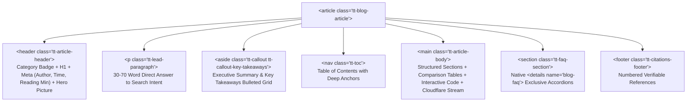

# Editorial Blog Post & Multimedia Standard (`@theme.tools/blog`)

Every blog post, technical article, and editorial guide generated across the fleet must be gorgeous, authoritative, standards-compliant, and fully optimized for both traditional search ranking (Google, Bing) and Generative Engine Optimization (Perplexity, ChatGPT Search, Claude, Gemini).

---

## 1. Information Gain & E-E-A-T Architecture

Generic paraphrasing of existing SERP summaries is strictly banned by Google Core Updates and LLM retrieval engines:
- **Net-New Information Mandate**: Every article must contribute verifiable primary evidence:
  - Original benchmark results with exact measured latencies, throughputs, or error rates.
  - Firsthand architectural breakdowns, production failure retrospectives, or code implementations.
  - Proprietary decision frameworks or comparison matrices with quantified trade-offs.
- **Verifiable Author Entity**: Every post must attribute a named author with `Person` JSON-LD schema, professional title, and external verified profiles (`sameAs` links to GitHub, LinkedIn, or personal domain).
- **Claim-Level Primary Citations**: Factual, numerical, or pricing claims must link to primary documentation, official RFCs, or academic sources using `rel="noopener noreferrer" target="_blank"` and appear in the terminal `<footer class="tt-citations-footer">`.

---

## 2. Semantic HTML5 DOM Layout

Articles must be structured using clean, semantic HTML5 elements without div-soup:



1. **Root Wrapper**: `<article class="tt-blog-article">` with max-width 768px for optimal reading line length (60–75 characters per line).
2. **Article Header**:
   - Distinctive category badge pill with OKLCH theme colors.
   - Exactly ONE `<h1>` title (benefit-first, specific, ≤12 words).
   - Author avatar, name, publication date wrapped in `<time datetime="YYYY-MM-DD">`, and reading time estimate.
   - Hero picture with explicit 1200×630 aspect ratio and `fetchpriority="high"`.
3. **Direct-Answer Lead Paragraph**: First paragraph (`.tt-lead-paragraph`) directly and concisely answers the core query in 30–70 words.
4. **Executive Key Takeaways Callout**: `<aside class="tt-callout tt-callout-key-takeaways">` summarizing 3–5 core insights.
5. **Interactive Table of Contents**: `<nav class="tt-toc">` with clean anchor links matching `slugify(h2/h3)`.
6. **Native FAQ Accordions**: Render FAQs using native `<details name="blog-faq">` exclusive accordions (zero JavaScript overhead, keyboard-accessible, SEO crawlable).

---

## 3. High-Velocity Multimedia Integration (`@theme.tools/blog`)

All media must maintain **Zero Cumulative Layout Shift (CLS = 0)**:

### Responsive Next-Gen Pictures
Never render bare `` tags without dimensions. Use [`renderResponsivePicture`](file:///Users/Apple/emdash/repositories/theme.tools/packages/blog/src/multimedia.ts):
```html
<picture>
  <source type="image/avif" srcset="/images/hero.avif" />
  <source type="image/webp" srcset="/images/hero.webp" />
  
</picture>
```

### Cloudflare Stream & Video SEO
Embed videos using [`renderCloudflareStreamEmbed`](file:///Users/Apple/emdash/repositories/theme.tools/packages/blog/src/multimedia.ts):
- Responsive 16:9 wrapper with lazy-loaded iframe.
- Paired `VideoObject` Schema.org JSON-LD with thumbnail, upload date, duration (`PTxMxS`), and `hasPart` chapter clips.
- Full transcript disclosure rendered in `<details class="tt-video-transcript">` for deep search indexing.

### Interactive Syntax-Highlighted Code Blocks
Use [`renderInteractiveCodeBlock`](file:///Users/Apple/emdash/repositories/theme.tools/packages/blog/src/multimedia.ts):
- Header displaying the file path/filename and language badge.
- Monospace font with accessible contrast on deep space canvas (`#060610`).

---

## 4. Generative Engine Optimization (GEO) Standards

To ensure conversational AI agents (Perplexity, ChatGPT, Claude, Gemini) cite the post:
1. **Quotable Answer Blocks**: Place a self-contained 30–70 word declarative answer block immediately under every informational `<h2>` heading.
2. **Comparison Tables**: Convert narrative feature or performance comparisons into structured HTML tables with explicit column headers and binary `✓`/`✗` marks.
3. **Operational Step-by-Step Sequences**: Format instructions into numbered lists (`<ol>`) with bold action verbs.
4. **Anti-AI-Slop Voice**: Zero occurrences of banned buzzwords (`delve`, `leverage`, `seamless`, `robust`, `synergy`, `elevate`, `cutting-edge`). Maintain Flesch Reading Ease ≥60.

---

## 5. Machine-Readable Schema.org JSON-LD

Every blog post must render a single, validated JSON-LD block:
- **`BlogPosting`** for thought leadership, analysis, and product essays.
- **`TechArticle`** for developer tutorials, engineering deep-dives, and code walkthroughs.
- Mandatory fields:
  - `headline`, `description`, `image`, `datePublished`, `dateModified`.
  - `author`: `Person` with `name`, `url`, and `sameAs`.
  - `publisher`: `Organization` with `name` and `logo`.
  - `speakable`: CSS selectors for voice assistants (`.tt-lead-paragraph`, `.tt-key-takeaways`).
  - `citation`: Array of primary external sources.
  - `hasPart`: Embedded clips or chapters for attached videos.

---

## 6. Pre-Publish Validation Gate

Every article must pass the automated validator before release:
```bash
node ~/.agentskills/bin/blog-post-validator.ts --file path/to/article.html
```
Must achieve a 100/100 audit score across all structural, schema, readability, and multimedia checks.
