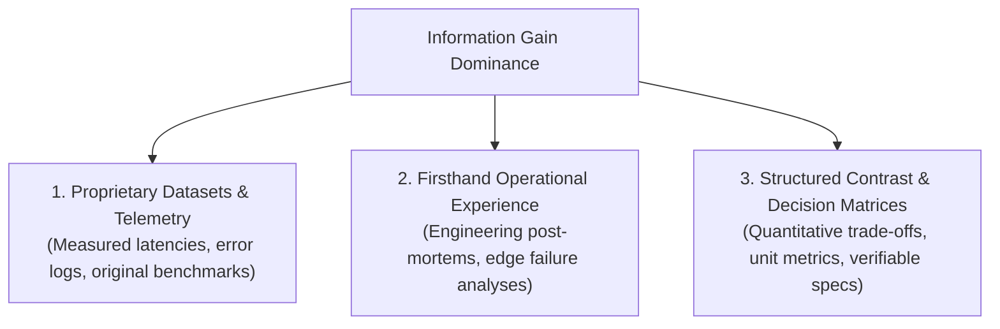

# Information Gain & Original Research Doctrine (SEO + GEO 2026)

Under Google's operationalized **Contextual Estimation of Link Information Gain** patent and frontier Generative Engine Optimization (GEO) research, content that merely aggregates or paraphrases existing search results suffers severe algorithmic de-ranking.

Search algorithms and conversational RAG models (Perplexity, ChatGPT, Claude, Google AI Overviews) evaluate how much **net-new, non-redundant knowledge** a document adds to the collective knowledge pool.

---

## 1. The Information Gain Triangle

### 1. Proprietary Datasets & Benchmarks
Every long-form technical article or guide must contribute unique empirical numbers:
- Real test results (e.g., *"Cloudflare Durable Objects maintained 14.2ms P99 latency under 20,000 req/sec"*).
- Original cost breakdowns and pricing models.
- Hardware/runtime measurements that exist nowhere else on the public web.

### 2. Firsthand Operational Proof
Eliminate hypothetical consensus advice (*"Docker helps developers run containers easily"*). Provide real engineering mechanics:
- Exact configuration files, memory limits, and runtime flags.
- Edge failure post-mortems explaining why naive architectures failed.
- Architectural trade-off analysis explaining why alternative solutions were rejected.

### 3. Structured Contrast & Decision Matrices
AI search tools synthesize tabular data over flowing prose. Convert narrative comparisons into structured HTML tables featuring:
- Explicit unit values (ms, req/s, $/GB, MB RAM).
- Binary compliance checkmarks (`✓` / `✗`).
- Named trade-off columns highlighting operational boundaries.

---

## 2. Generative Search Citation Mechanics

Research from Princeton, Georgia Tech, and IIT Delhi proves that applying specific structured techniques increases an LLM's probability of citing a page by **30% to 42%**:

1. **Fact-Density & Quantitative Substitution**:
   - Qualitative: *"Our cache delivers lightning-fast performance for edge clients."*
   - Quantitative: *"Our cache delivers 8.4ms P95 response times across 320 Cloudflare edge locations, cutting origin load by 87%."*
2. **Direct-Answer Lead Paragraphs**:
   - Immediately follow informational `<h2>`/`<h3>` headings with a self-contained 30–70 word declarative answer block. RAG vectorizers extract these chunks verbatim for snippet presentation.
3. **Named Entity Attribution**:
   - Attribute findings to named domain experts with `Person` Schema.org profiles linked via `sameAs` to **ORCID** and **Wikidata**.
4. **Primary Source Footnotes**:
   - Outbound citations to official RFCs, GitHub commits, or academic papers signal that the page is grounded within the verified global knowledge graph.

---

## 3. Anti-AI-Slop Voice Enforcement

Zero tolerance for generic filler, conversational padding, or AI buzzwords:
- **Banned Vocabulary**: delve, leverage, unleash, revolutionize, seamless, robust, synergy, elevate, empower, transformative, best-in-class, cutting-edge, discover, innovative, game-changer, tapestry, beacon, testament.
- Maintain Flesch Reading Ease ≥55 (≥35 for `TechArticle`).
- Keep sentence lengths under 25 words with active voice (>90%).
