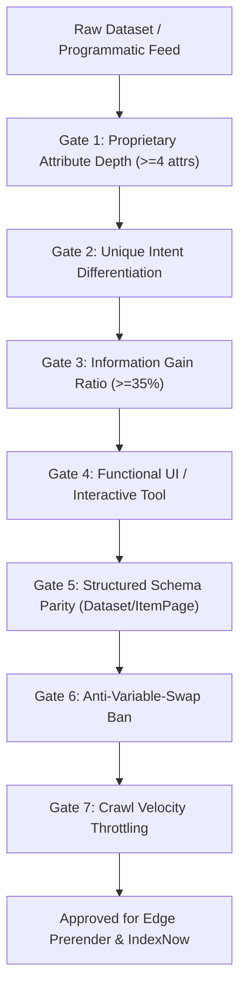

# Programmatic SEO (pSEO) Quality Gate & Anti-Scaled-Content Doctrine

Following Google's algorithmic updates targeting **Scaled Content Abuse**, legacy "copy-and-swap" programmatic generation (e.g., swapping city names, tool names, or zip codes into identical template prose) is strictly banned across the fleet.

Hosting thin programmatic pages damages site-wide trust, suppressing search visibility across hand-written core pages. Every programmatic template must pass the **7 Programmatic Quality Gates** prior to index submission.

---

## The 7 Programmatic Quality Gates



### Gate 1: Proprietary Database Requirement
Every programmatic URL must be anchored by a structured dataset containing at least **4 unique, quantitative, proprietary attributes** per row (e.g., measured latency, spread percentage, verified fee, user review distribution, benchmark metrics). Pages generated from generic LLM prompts without structured database fields fail automatically.

### Gate 2: The "Unique Intent" Threshold
A programmatic variant is only permissible if it answers an unambiguous, distinct user intent. If Query A (`"docker hosting in austin"`) and Query B (`"docker hosting in dallas"`) yield identical search results and have no physical local infrastructure distinctions, they must be consolidated into a single regional hub page.

### Gate 3: Information Gain Ratio (≥35% Dissimilarity)
The ratio of unique contextual content and proprietary data to template boilerplate must exceed **35%** (measured via vocabulary dissimilarity). If two generated pages share 90% identical sentences with only entity swapping, the batch fails.

### Gate 4: Functional UI / Interactive Utility
Programmatic pages cannot be passive walls of text. Every template must render an interactive utility:
- Live dynamic calculators (e.g., currency converter, ROI estimator, pricing estimator).
- Interactive comparison matrices with sorting/filtering.
- Verified data charts or SVG visualizations.

### Gate 5: Structured Entity Schema Parity
Every programmatic page must declare accurate, non-padded Schema.org entities:
- `Dataset` schema with `variableMeasured`, `temporalCoverage`, and `distribution`.
- `ItemPage` or `SoftwareApplication` with exact specifications.
- `BreadcrumbList` linking back to the parent category hub.

### Gate 6: Anti-Variable-Swap Ban
Never generate automated articles by regex-replacing keywords into identical boilerplate paragraphs. Content blocks must dynamically adapt their structure, headings, and takeaways based on the unique attributes of the underlying entity.

### Gate 7: Publication Velocity Throttling
Never publish tens of thousands of programmatic URLs in an overnight batch. Release programmatic silos in staged cohorts (e.g., 50–200 pages per batch), monitored via Google Search Console and IndexNow, to maintain crawl budget harmony.

---

## Automated Verification

Audit programmatic batches using the CLI quality gate:
```bash
node ~/.agentskills/bin/pseo-quality-gate.ts --dataset path/to/dataset.json
```
Requires an overall batch grade of `PASS` (100% compliance across all 7 gates) before release.
